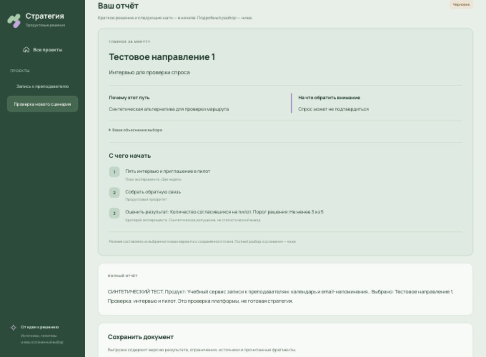

# Помощник продуктовой стратегии

Локальное веб-приложение помогает пройти путь от брифа до проверяемого плана продуктовой и коммуникационной стратегии. Оно уточняет условия, читает предоставленные материалы и, при настроенном Tavily, веб-страницы; сравнивает три направления, проверяет обещания и ограничения, оставляет выбор за человеком и сохраняет отчёт. Система готовит решение и план проверки гипотез, а не проводит продажи или доказывает рыночный спрос.



## Быстрый запуск

Нужны Python 3.12, [uv](https://docs.astral.sh/uv/) и доступ к выбранной модели. Из корня репозитория:

```bash
uv sync --locked
cp -n .env.example .env
.venv/bin/python -E -m scripts.run_local
```

Откройте [http://127.0.0.1:8000](http://127.0.0.1:8000). Команда поднимает интерфейс и отдельный worker; `Ctrl+C` останавливает оба процесса. Настройки читаются из локального `.env`, который исключён из Git. При необходимости задайте `APP_PORT` или `APP_DATA_DIR` через параметры `--port` и `--data-dir` команды запуска. Состояние хранится в `data/`.

По умолчанию используется авторизованный Codex CLI (`APP_MODEL_PROVIDER=codex`). Для OpenRouter нужны `APP_MODEL_PROVIDER=openrouter`, точный `APP_MODEL_NAME` и `APP_MODEL_API_KEY`. Для веб-поиска нужен `APP_TAVILY_API_KEY`; без него можно исследовать только явно подключённые файлы TXT/Markdown. Их путь задаётся `APP_RESEARCH_MATERIALS_DIR`, список — JSON-массивом в `APP_RESEARCH_FILES`. [Подробности моделей](app/llm/README.md) · [Поиск и материалы](docs/usage.md).

Для просмотра полностью синтетического процесса без модели и поиска:

```bash
.venv/bin/python -E -m scripts.run_local --demo --data-dir data/demo
```

Этот режим проверяет работу интерфейса и хранения, но не качество стратегии.

## Как работать

1. Создайте проект: опишите работающие функции продукта, цель, аудиторию, срок, бюджет и ограничения.
2. Запустите анализ. Ответьте на уточнения, если они появились. В разделе источников проверьте, какие файлы и веб-страницы действительно прочитаны.
3. Сравните направления, возражения и эксперименты. Выбор направления и объяснение делает человек.
4. Прочитайте итог и выгрузите Markdown или HTML. Служебные записи этапов и расходов остаются в истории запуска.
5. При изменении бюджета или запретов остановите активную работу, исправьте условия и продолжите анализ. Предыдущая версия сохраняется.

[Пошаговая инструкция](docs/usage.md) · [Пример комплексного теста](materials/complex-repair/README.md) · [Результат этого теста](materials/complex-repair/results/RESULT.md)

## Проверки

```bash
.venv/bin/python -E -m pytest -q
node --test tests/test_markdown.mjs tests/test_report_model.mjs tests/ui/*.mjs
.venv/bin/python -E scripts/check_contracts.py
.venv/bin/python -E -m scripts.check_secrets
```

Обычные тесты не должны обращаться к реальным платным сервисам; живые проверки запускаются отдельно и могут расходовать лимиты аккаунта. [Каталог тестов и кейсов](docs/testing.md) · [Оценка на новых задачах](evals/README.md).

## Устройство и ограничения

HTTP-сервер принимает действия пользователя, отдельный worker выполняет этапы, SQLite сохраняет версии, контрольные точки, источники, расходы и историю. Модель подключается через Codex CLI или OpenRouter; внешний поиск — через Tavily. Приложение предназначено для локальной установки и не имеет многопользовательской авторизации. Точность рыночных выводов зависит от качества предоставленных данных и прочитанных источников. Неизвестная цена вызовов не означает нулевые расходы.

[Архитектура](docs/architecture.md) · [Контракты](contracts/README.md) · [API](app/api/README.md) · [Docker и подробная настройка](docs/development.md) · [Рабочие промпты](prompts/README.md)

## Материалы проекта

[Исходное ТЗ](project-notes/task) задаёт критерии оценки: проверяемые источники, разделение фактов и гипотез, разные альтернативы и сильные возражения, связность продуктовой и коммуникационной стратегий, управление человеком и воспроизводимый запуск. [Комплект для конкурса](docs/submission.md) отделён от рабочей документации. Исторические планы и протоколы участников сохранены в [архиве проекта](project-notes/README.md).

## Проверяющим и участникам

Начните с [описания работы со скриншотами](docs/submission-report.md) и [таблицы соответствия ТЗ](docs/requirements.md). [Инструкции разработки](docs/development-prompts.md) отделены от [рабочих промптов](prompts/README.md). Статус внешней публикации и оставшиеся действия — в [комплекте сдачи](docs/submission.md).

Код — `app/`, автоматические проверки — `tests/`, сравнительная оценка — `evals/`, ручные кейсы — `materials/`, актуальная документация — `docs/`, история участников — `project-notes/archive/`. Личные документы участников и ключи в репозиторий не входят.
