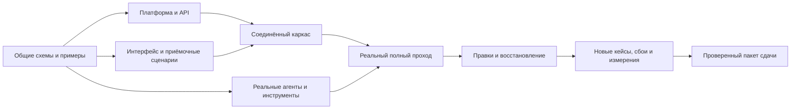

Roadmap разработки для команды из трёх человек

Основание: `task` и концепция в `PLAN.md`. Календарной привязки нет: порядок задаётся зависимостями и критериями готовности. Все перечисленные работы запланированы; наличие документа не означает, что компоненты уже реализованы. Номера участников можно заменить именами команды.

1. **Распределение ответственности.**

| Участник | Зона ответственности | Итоговый результат | Персональный план |
|---|---|---|---|
| 1 | Платформа: схемы, API, выполнение, хранилище, версии, восстановление, расходы, установка | Приложение выполняет и сохраняет процесс; им можно управлять через API | [План участника 1](team/PARTICIPANT_1.md) |
| 2 | Агенты: бриф, исследование, источники, продуктовая и коммуникационная стратегии, критик, контекст | Новый запрос превращается в обоснованную согласованную стратегию | [План участника 2](team/PARTICIPANT_2.md) |
| 3 | Интерфейс, выгрузки, независимая приёмка, сравнения, демонстрация и сборка материалов | Пользователь может пройти весь сценарий; качество и ограничения подтверждены | [План участника 3](team/PARTICIPANT_3.md) |

Каждый пишет документацию и проверки собственного модуля. Участник 3 собирает общий пакет, участник 1 отвечает за техническую интеграцию. Общая ответственность команды не заменяет персонального владельца задачи.

При разном опыте команды участнику 1 лучше поручить человеку с опытом backend, участнику 2 — с опытом LLM и анализа, участнику 3 — с опытом интерфейсов и проверки пользовательских сценариев. Это рекомендация по назначению, а не требование к составу команды.

2. **Границы обязательного результата.**

Базовый продукт — локально запускаемый помощник руководителя продукта. Поддерживаются текстовый бриф, открытые ссылки и разрешённые TXT/Markdown-материалы, отчёт на русском языке, один активный запуск на установку.

Полный путь: бриф → необходимые уточнения → исследование → факты и гипотезы → разные продуктовые направления → коммуникации → критика → выбор/правка человеком → стратегия и эксперименты → выгрузка.

Обязательны источники с подтверждающими фрагментами, три различающихся варианта, возражения, связь обещаний с возможностями, план проверки, вмешательство, сохранение, продолжение после перезапуска, новый кейс, учёт расходов, защита секретов, инструкция запуска и материалы сдачи.

Приоритет P0 означает основу первого полного прохода; P1 — обязательное доведение до приёмки; P2 — дополнительные возможности. Все P0 и P1 входят в готовое решение. Дополнительные функции не блокируют сдачу.

Предлагаемый демонстрационный кейс — условный сервис расписания и напоминаний для частных преподавателей. Возможности, бюджет и команда внутри этого кейса — исходные данные вымышленного продукта; их нельзя путать с составом вашей команды из трёх человек.

3. **Общие контракты до независимой разработки модулей — M0.**

Участник 1 оформляет схемы, участник 2 проверяет смысл данных, участник 3 — достаточность данных для экранов и проверок. Решения фиксируются в репозитории и обсуждаются до изменения несовместимых форматов.

| Контракт | Что согласовать | Владелец |
|---|---|---|
| Объекты | BriefVersion, Capability, Source, Claim, StrategyOption, Decision, Experiment, ReviewIssue, Artifact, Run, Usage | 1, согласуют 2 и 3 |
| Происхождение и версии | ID, версия брифа, версии схемы/промпта/модели, зависимости, источник данных, актуальность | 1 и 2, проверяет 3 |
| Результат этапа | Входные ссылки и ограничения → структурированные артефакты, замечания, запрос ввода, рекомендуемый следующий шаг | 1 и 2 |
| Вызовы моделей и инструментов | Общий адаптер, тайм-ауты, ошибки, лимиты и события использования; единый учёт без двойного начисления | 1, потребитель 2 |
| Управление | Создать проект/запуск, получить статус и артефакты, ответить на вопросы, поставить на паузу, продолжить, изменить бриф, выбрать вариант, выгрузить | 1, потребитель 3 |
| Зависимости | Какие изменения делают исследование, варианты, коммуникации и эксперименты устаревшими | 2 описывает, 1 реализует, 3 показывает |
| Отчёт | Какие проверенные данные попадают в резюме и разделы, как отображаются источники и пробелы | 3, согласует 2 |

Статусы запуска: `queued`, `running`, `pause_requested`, `paused`, `waiting_for_input`, `completed`, `failed`, `incomplete`. Согласовать допустимые переходы и различие «технически завершён» / «получен неполный результат». Состояние качества отчёта хранить отдельно: черновик, есть блокирующие замечания, готов к использованию с указанными ограничениями.

Агенты не пишут напрямую в SQLite и не меняют статусы запуска. Платформа предоставляет адаптеры и хранилище артефактов; агент возвращает структурированный результат. Переходы процесса, сохранение и учёт выполняет платформа. Сборщик отчёта отображает эти объекты и не добавляет новые факты.

У `ReviewIssue` должны быть код, важность, затронутый объект, основание, предлагаемое исправление и этап возврата. Максимум циклов исправления задаётся конфигурацией. Блокирующие замечания запрещают выдавать документ как проверенный; черновую выгрузку можно разрешить с явным статусом.

Подготовить согласованные JSON-примеры: обычный результат, неполный бриф, противоречащие источники, отсутствующая возможность, ошибка поиска и устаревший результат. По этим примерам все трое начинают работу параллельно. Тестовые результаты явно обозначаются и не считаются работающим исследованием.

M0 принят, когда все три модуля могут использовать одни и те же примеры без ручного переименования полей.

4. **Параллельная разработка каркаса — M1.**

| Участник | Задачи | Результат для остальных |
|---|---|---|
| 1 | A2–A6 в минимальном объёме: конфигурация, адаптер, хранение, тестовый исполнитель, API | Можно создать запуск, выполнить шаг, получить статус и сохранённый артефакт |
| 2 | Начальная часть B8, B1, B2 и каркас B3–B6: доступная модель, промпты, бриф, поиск и функции этапов | Этапы соответствуют общим схемам; есть первый реальный вызов модели и поиска |
| 3 | C1, C2, начало C7: сценарии, интерфейс, API-клиент и приёмочные примеры | Бриф отправляется через интерфейс, результат читается из API |

Первое соединение: ввод в интерфейсе → API → тестовый этап → сохранение → отображение. Перезагрузка страницы не теряет проект. Установку и минимальные события использования подключить уже здесь.

5. **Первый реальный полный проход — M2.**

| Участник | Задачи | Результат |
|---|---|---|
| 1 | Соединить реальные этапы, обработать уточнения и выбор, сохранять результаты и использование | Запуск проходит через платформу без ручной передачи данных |
| 2 | B1–B6 в базовом объёме: реальные источники, три варианта, коммуникации, критика и эксперименты | Структурированная стратегия с доказательствами и ограничениями |
| 3 | C3–C6: прогресс, источники, варианты, выбор, итоговый документ и выгрузка | Пользователь проходит сценарий через интерфейс |

Критерий M2: из нового брифа получается скачиваемая стратегия через настоящие вызовы сервисов. Критические пробелы видны. Ручное копирование ответов моделей между этапами не требуется. Настройку качества продолжать после появления этого прохода.

6. **Управляемость и согласованность — M3.**

Участник 2 сначала передаёт карту зависимостей B7; участник 1 реализует A7–A8: паузу, восстановление, версии, пересчёт и ограничения; участник 3 подключает управление C3–C5 и актуальность в C6. Строгую критику и настройку B6–B8 участник 2 доводит параллельно. Сценарий принимается совместно после соединения частей; экраны не являются предварительным условием реализации API.

Общий сценарий: уменьшить бюджет и запретить платную рекламу → сохранить новую версию → пересчитать затронутые рекомендации → показать изменения → завершить процесс приложения → запустить снова → продолжить с сохранённой точки.

Проверить отдельно паузу пользователя, ожидание ответа и аварийное завершение. Завершённые актуальные этапы повторно не выполняются без причины. Незавершённый внешний вызов после сбоя может повториться; ограничение фиксируется в документации.

M3 принят, когда в новом отчёте нет несовместимых рекомендаций из старой версии, а восстановление проверено реальным перезапуском процесса и сохранением данных на диске.

7. **Качество, устойчивость и измерение пользы — M4.**

Участник 3 ведёт независимый набор проверок C7–C9. Участник 1 устраняет технические дефекты и предоставляет измерения; участник 2 исправляет качество агентов и пополняет свои регрессионные примеры.

| Проверка | Ответственный за проведение | Кто исправляет |
|---|---|---|
| Чистая установка и полный проход | 3 | 1, при необходимости 2 |
| Перезапуск, пауза, версии, повтор запроса | 3 с 1 | 1 |
| Проверка утверждений по фрагментам | 3, выборочно 1 | 2 |
| Различия альтернатив, обещания и эксперименты | 3, выборочно 1 | 2 |
| Новые продукты вне примера настройки | 3 | Владелец дефектного компонента: 1, 2 или 3 |
| Поиск недоступен, тайм-аут модели, лимит исчерпан | 3 | 1 и 2 |
| Инструкции внутри внешнего текста | 3 | 2; ограничения инструментов — 1 |
| Секреты и закрытые данные в Git/логах/выгрузках | 1, повторная проверка 3 | Автор дефекта |
| Измерение пользы критика и нескольких ролей | 3 | Данные и режимы предоставляют 1 и 2 |

Сравнивать один вызов модели с процессом и процесс с критиком/без него на одинаковых брифах и источниках. Исполнители одновызовного режима и режима без критика готовит участник 2 в B8; участник 1 обеспечивает единый учёт, участник 3 проводит измерения. Фиксировать время, расходы, неподтверждённые утверждения, невозможные обещания, различия альтернатив и пригодность экспериментов. Проверочные кейсы отделить от примеров настройки; после исправлений на раскрытом кейсе добавить новый независимый пример.

M4 принят, когда обязательные сценарии проходят, блокирующие дефекты закрыты, известные ограничения записаны и есть фактические измерения. Небольшой набор испытаний не даёт основания заявлять универсальную точность.

8. **Сборка сдачи — M5.**

| Материал | Готовит | Проверяет |
|---|---|---|
| Репозиторий, инструкция установки, конфигурация без ключей | 1 | 3 запускает с нуля |
| Архитектура выполнения, сохранение, метрики и расходы | 1 | 2 и 3 |
| Модели, инструменты, промпты и работа с источниками | 2 | 1 и 3 |
| Скриншоты, пользовательский сценарий и ограничения интерфейса | 3 | 1 и 2 |
| Сравнения, протокол проверок и заявляемые возможности | 3 | Вся команда |
| Общий PDF/документ и видео | 3 собирает материалы всех | Вся команда |
| Полные правила, комплектность, доступ к ссылкам и отправка | 3 координирует | 1 проверяет ссылки, 2 проверяет содержимое |

Каждый ведёт собственный журнал промптов при разработке, ошибок, участия человека и затрат времени. Затраты API собираются платформой. В финальном документе отделить инструкции создания репозитория от runtime-промптов агентов.

Демонстрация: новый бриф → источники и подтверждающий фрагмент → варианты и возражения → изменение ограничений → пересчёт → реальный перезапуск → восстановление → итог и расходы → другой кейс. Использование кэша и заранее выполненные фрагменты обозначать явно.

M5 принят, когда другой участник запускает репозиторий по README, PDF читаем, ссылки открываются с требуемыми правами, видео соответствует фактическому поведению, документы участников подготовлены отдельно от данных приложения.

9. **Граф зависимостей и ранние передачи.**

Это порядок приёмки, а не запрет параллельной работы. Проверки, документация и минимальное восстановление начинаются при появлении соответствующего компонента. Полная приёмка идёт по M0 → M1 → M2 → M3 → M4 → M5.

| Передача | Что передать | Что принимающая сторона проверяет |
|---|---|---|
| 1 → 2 | Схемы, адаптер модели, контекст вызова и хранилище артефактов | Этап выполняется без прямого доступа к базе |
| 1 → 3 | API и примеры статусов, артефактов и ошибок | Интерфейс работает без импорта backend-кода |
| 2 → 1 | Функции этапов, выходные схемы, правила зависимости и возврата | Результат валидируется, сохраняется, ошибка обрабатывается |
| 2 → 3 | Полный пример стратегии, источников и замечаний | Его можно показать и выгрузить без дописывания фактов |
| 3 → 1 и 2 | Воспроизводимый сценарий дефекта с ID запуска и ожиданием | Понятен владелец и есть проверка исправления |

10. **Правила совместной работы.**

У каждой задачи есть один исполнитель, принимающий участник, зависимости, приоритет и наблюдаемый результат. Задачу можно начинать после согласования её входов; тестовые примеры позволяют не ждать окончания соседнего компонента.

Ветки по направлениям можно назвать `codex/platform`, `codex/agents`, `codex/interface`. Объединять небольшие законченные изменения. Схемы и API меняются через участника 1 после согласования с потребителями. Правки промптов и версий проходят через участника 2; правила вывода и приёмки — через участника 3.

Статусы задач: «готова к работе», «в работе», «ожидает зависимость», «на проверке», «готово». Длительная ветка без соединения с общим сценарием — повод выделить меньшую передачу и раннюю интеграцию.

Готовность задачи: код/промпт в репозитории; контракт соблюдён; значимые проверки пройдены; результат воспроизводим; документация актуальна; другой участник принял изменение. Для простых обратимых правок достаточно проверки существующего сценария — отдельный тест ради формальности не нужен.

Платформу и установку принимает 3, агентов и смысл результата принимает 3 с выборочной проверкой 1, интерфейс принимает 1 с участием 2. Дефект исправляет владелец компонента; участник 3 не становится единственным ответственным за все тесты и документацию.

11. **Дополнительный уровень — только после обязательного сценария.**

| Возможность P2 | Основной исполнитель | Условие добавления |
|---|---|---|
| Разные модели для разных этапов | 2, адаптер и учёт — 1 | Измеримо снижает стоимость или улучшает качество |
| Поиск по накопленной базе знаний | 2, хранение — 1 | Есть повторяющиеся документы и измеряется польза поиска |
| MCP-интеграция или CLI | 1 и 2 по конкретной задаче | Есть нужный источник/инструмент, который проще подключить этим способом |
| Модельные интервью | 2, маркировка и оценка — 3 | Используются для гипотез и подготовки реальных вопросов |
| Импорт PDF и более сложных форматов | 2, интерфейс — 3 | Есть нужные реальные материалы и проверяется качество извлечения |
| Дополнительные форматы выгрузки | 3 | Основной документ уже пригоден для использования |

Для каждого дополнения записывать проблему, базовый вариант, измеряемый эффект, стоимость и ограничения. Не расширять одновременно интерфейс, инфраструктуру и агентную логику без устойчивого M2.

12. **Итоговая приёмка по заданию.**

- [ ] Проработанность: проверяемые источники, явные гипотезы, разные варианты, возражения, согласованность и эксперименты.
- [ ] Нейротехнологии: понятные роли, маршрутизация, контекст и наблюдаемая польза компонентов.
- [ ] Имплементация: установка по инструкции, полный сценарий, вмешательство, восстановление, новый кейс, ошибки и секреты.
- [ ] Качество: понятная рекомендация, управляемость, измеренные время/расходы и документированные ограничения.
- [ ] Сдача: корректные ссылки, видео, документ со скриншотами, модели/инструменты/промпты и сведения об участии человека.
