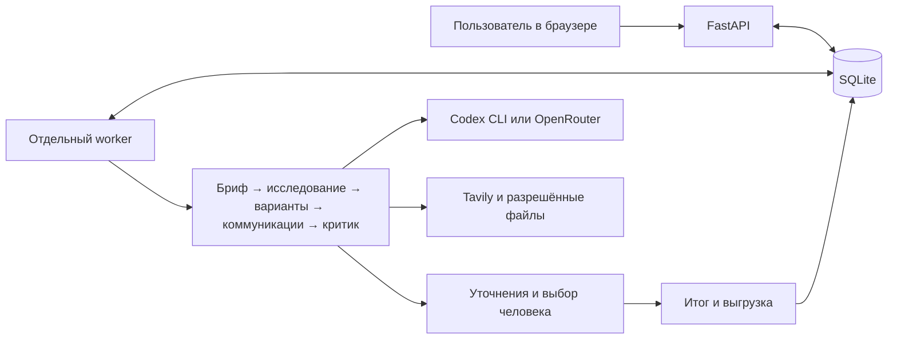

# Архитектура текущей версии

Сервер обслуживает интерфейс и команды; тяжёлые этапы исполняет worker. Оба используют один `APP_DATA_DIR`. Результат каждого этапа, версия брифа и точка продолжения фиксируются до следующего действия. Пауза может дождаться завершения уже начатого внешнего вызова. После перезапуска история сохраняется, продолжение требует действия человека.

Этапы реальных агентов подключены через `app.agents:build_stages`. Модель выбирается в `app/llm`, поиск и чтение файлов — в `app/tools/research.py`. Только программа вызывает инструменты: инструкции внутри прочитанной страницы или файла остаются данными. Утверждения содержат происхождение и степень проверки; найденный поисковый фрагмент не равен прочитанной странице.

Критик может вернуть план на исправление. Число таких циклов ограничено; незавершённый результат явно помечается. Выбор направления хранится как действие пользователя. Доступная функция и обещание клиенту связываются явно: запланированное нельзя выдавать за работающее. Состояние и исторические версии остаются в SQLite; новая выгрузка формируется из сохранённого снимка, а уже выданный документ не переписывается.

Сводка вызовов хранит попытки, время, токены и известную стоимость. Если провайдер не сообщает цену, она остаётся неизвестной. Деньги продуктового брифа и расходы на модель — разные ограничения. Общей авторизации, многопользовательской изоляции и автоматического доказательства рыночного спроса нет.

Точные форматы: [контракты](../contracts/README.md). Управление версиями: [правила вмешательства](../app/workflow/INTERVENTION.md). Хранение: [инструкция](../app/storage/README.md).
