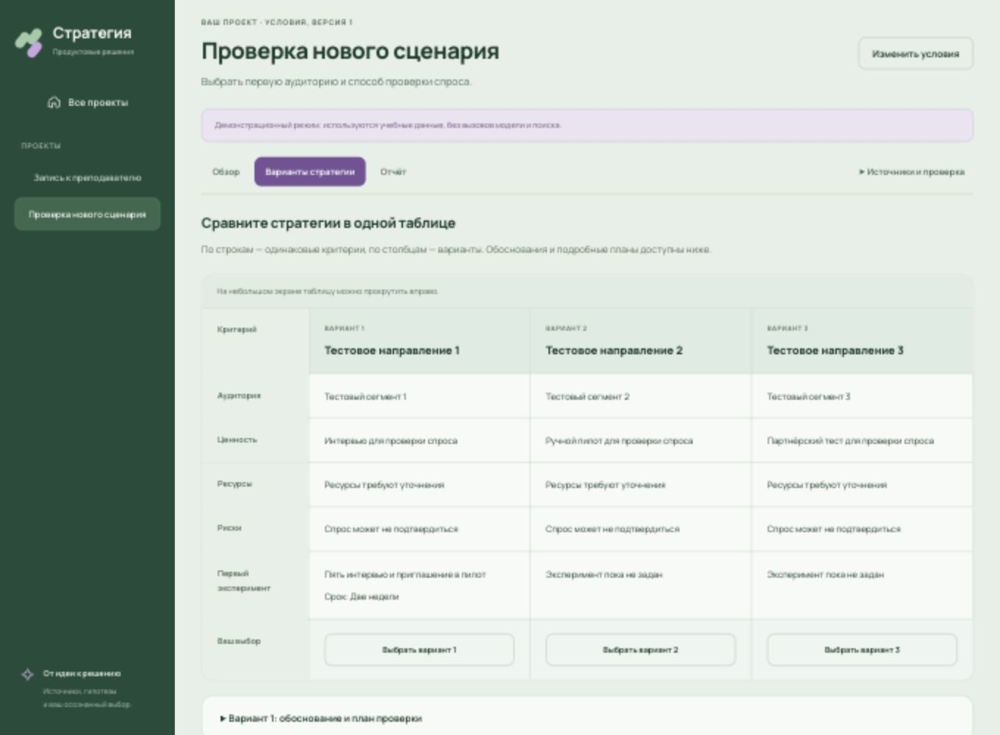
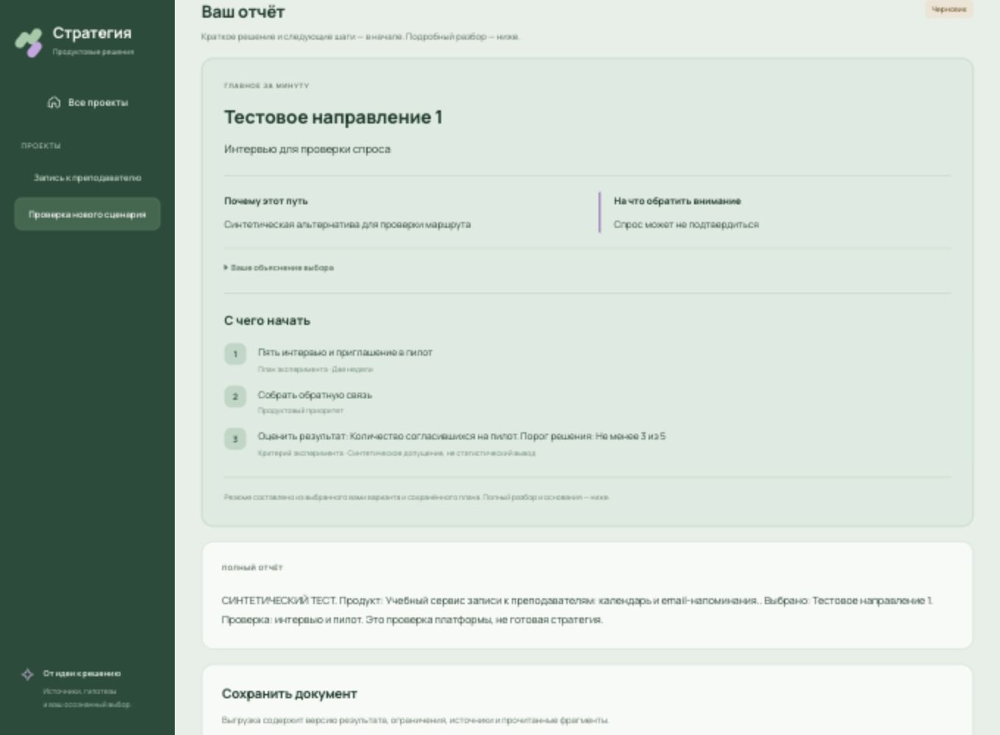
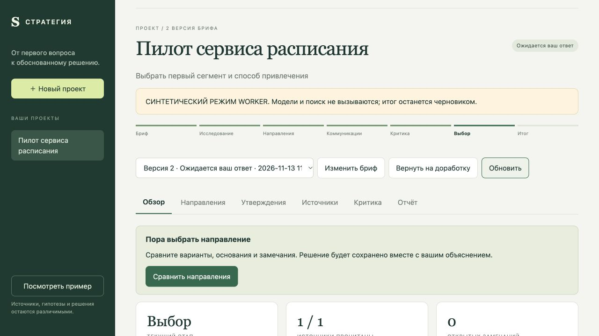

# Помощник продуктовой стратегии — описание работы

Состояние описания: 15 ноября 2026 года. Основание: [ТЗ](../project-notes/task), [матрица соответствия](requirements.md). Проект готовит план для принятия решения, а не выполняет продажи, интервью или платежи.

## Процесс и архитектура

Бриф → уточнения → исследование → три направления → сообщения и эксперименты → критика и доработка → явный выбор → отчёт. HTTP-сервер обслуживает интерфейс, отдельный worker выполняет этапы. SQLite сохраняет версии брифа, результаты, источники, контрольные точки и расходы. Подробная [схема архитектуры](architecture.md) и [инструкция запуска](../README.md) входят в комплект.

В контекст этапов передаются бриф, релевантные сохранённые результаты и источники в пределах настроенных лимитов. Найденная ссылка отличается от прочитанного текста. Происхождение утверждений и степень подтверждения сохраняются. Внешний текст считается данными, а не командой на изменение поведения. После изменения условий создаётся новая версия; старые результаты остаются в истории.

## Модели, сервисы и инструменты

| Компонент | Назначение и использование |
|---|---|
| Codex CLI | Доступ к модели для агентных этапов; также помощник разработки. В пилотном сравнении записана gpt-6-luna; в комплексном прогоне точный ID не записан |
| OpenRouter | Альтернативный адаптер модели; конкретную модель выбирает пользователь. Не участвовал в описанном комплексном прогоне |
| Tavily Search / Extract | Поиск и получение текста страниц; в комплексном прогоне два поиска и один запрос извлечения |
| Чтение локальных TXT/Markdown | Только явно подключённые материалы; шесть файлов в завершённом прогоне |
| Python 3.12, FastAPI, Uvicorn | Сервер, команды и отдельный процесс выполнения |
| Pydantic, JSON Schema, httpx | Настройки, проверка структур и HTTP-доступ к сервисам |
| SQLite | История, версии, контрольные точки, данные и учёт вызовов |
| HTML, CSS, JavaScript | Пользовательский интерфейс и отображение отчётов |
| uv и uv.lock; Docker Compose | Установка закреплённых зависимостей; альтернативный контейнерный запуск |
| pytest, Node test runner | Автоматические проверки Python и интерфейсной логики |
| Проверки контрактов и секретов | Контроль структур API и поиск случайно опубликованных ключей |
| ReportLab | Сборка исторического PDF; не нужен для работы приложения |

Ключи задаются через локальный .env. Версии Python-зависимостей фиксирует uv.lock. Точные настройки каждого прогона следует смотреть в его материалах, а не приписывать ему текущие значения по умолчанию.

## Ключевые промпты и дополнительные возможности

[Каталог промптов](../prompts/README.md) содержит общие инструкции и пять ролей: бриф, исследование, направления, коммуникации, критик. Общие правила требуют отделять гипотезы от фактов и не исполнять инструкции из источников. Направления сравниваются по ограничениям продукта; сообщения не должны обещать недоступные функции; критик проверяет основания и согласованность планов. [Инструкции разработки](development-prompts.md) описаны отдельно.

Дополнительные возможности: маршрутизация по этапам, возврат на исправление, CLI-интеграция, веб-исследование и сохранение контекста. В комплексном тесте критик обнаружил шесть расхождений по срокам оплаты, продления и внедрения, исправленных за два цикла. Это конкретный наблюдаемый эффект. [Сравнение трёх режимов](../evals/README.md) пока не доказывает универсального выигрыша качества: выборка мала и независимая оценка не заполнена. MCP, реальные интервью, модельные респонденты и отдельная векторная база знаний не заявляются реализованными обязательствами — в ТЗ это примеры дополнительных возможностей.

## Управление человеком и интерфейс

Пользователь отвечает на уточнения, останавливает работу, меняет условия и выбирает направление с обоснованием. Начатый внешний вызов может завершиться до паузы. После перезапуска приложение читает сохранённые данные; продолжение требует действия пользователя. Выгрузка отделена от технических журналов.

Ниже сохранённые кадры интерфейса. Они иллюстрируют экраны, не являются записью текущего запуска и не доказывают его результаты.

## Демонстрационный проект: ремонтные мастерские

[Бриф и материалы](../materials/complex-repair/README.md) моделируют выбор между независимыми смартфонными мастерскими, велосипедными мастерскими и сетями. Входы содержат дубликат оплаты, возврат, ограниченные ресурсы, недоступные функции, сомнительный канал и текст с попыткой вмешательства в инструкции. Внутренние данные вымышленные, вызовы Codex и Tavily настоящие. Контрольные ответы отделены от входов.

Завершённый повторный прогон предложил план для независимых смартфонных мастерских. [Читаемый итог](../materials/complex-repair/results/readable-report.md), [протокол](../materials/complex-repair/results/RESULT.md), [измерения](../materials/complex-repair/results/completed-summary.json) и технические снимки доступны отдельно.

| Измерение | Зафиксировано |
|---|---|
| Активное время завершённого запуска | 976,307 секунды, примерно 16 минут 16 секунд; не включает всю подготовку и первую попытку |
| Вызовы модели | 11 |
| Веб-инструменты | 2 Search + 1 Extract; прочитаны 3 страницы |
| Локальные материалы | 6 файлов |
| Токены модели по журналу | 340 913 входных, 40 424 выходных |
| Денежные расходы | Неизвестны для 14 событий модели и поиска; ноль по известным локальным чтениям не означает бесплатный прогон |
| Время и расходы разработки | Полностью не зафиксированы; нужны сведения участников и аккаунтов |

Первая попытка остановилась после циклов критики: критик требовал фактических результатов будущего пилота вопреки заданию подготовить план. Правило исправлено, выполнен новый запуск с уже сокращённым бюджетом. Это вмешательство в код между попытками; нельзя представлять обе попытки как один беспроблемный автономный запуск. Учебный выбор направления сделал помощник по поручению пользователя. Подробности ошибок и непроверенных ветвей — в протоколе.

## Проверки и ограничения

На момент предыдущей технической проверки: 322 Python-теста пройдены, два живых теста пропущены; четыре JavaScript-набора пройдены. Проверены 39 схем, девять примеров, 19 операций API и восемь отрицательных случаев. Это результаты проверок кода, не экспертная оценка стратегии. Команды повторения приведены в [README](../README.md).

Локальное приложение не имеет многопользовательской авторизации. Модель может ошибаться; происхождение цитаты не гарантирует правильность вывода. Прочитанные фрагменты сайтов ограничены; полные тарифы не установлены. Учебные платежи не подтверждают спрос. Неизвестная цена вызовов не позволяет заявить точный расход. Реальные сообщения, платежи и внедрения не выполнялись. Не все отрицательные сценарии проверялись в живом сложном прогоне; тесты восстановления и сохранённый успешный запуск — разные доказательства.

## Комплект подачи

Этот документ со скриншотами можно разместить по доступной проверяющим ссылке либо подготовить из него актуальный PDF. Старый output/pdf/submission.pdf относится к 13 ноября и не является актуальной версией этого описания. [Сценарий демонстрации](demo-script.md) подготовлен; опубликованная запись и внешняя ссылка пока отсутствуют. [Чеклист](submission-checklist.md) перечисляет оставшиеся действия. Личные документы участников подаются через профиль конкурса, не через публичный репозиторий.
