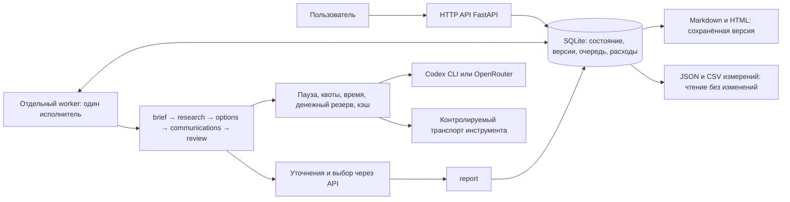

Техническая часть сдачи: платформа

Состояние на 12 ноября 2026: платформа A1–A9 и технические материалы A10 подготовлены. В master работает синтетический сквозной сценарий. Реальные агенты участника 2, интерфейс и итоговый renderer участника 3 ещё не приняты в общий процесс. Этот документ описывает реализованные свойства платформы, а не подтверждение качества реальной стратегии.

**Архитектура выполнения.**



HTTP-сервер принимает команды и отдаёт состояние; тяжёлые этапы выполняет отдельный процесс worker. SQLite — источник истины. Только один worker владеет блокировкой Unix flock; только один Run выполняется активно на установке. База и файлы находятся в APP_DATA_DIR на локальной файловой системе. Перерисовка интерфейса или перезапуск HTTP-сервера не отменяют работу worker.

Функция этапа получает StageRequest и StageContext и возвращает StageResult. Контракты проверяются по JSON Schema; платформа проверяет ссылки, версии, ограничения и выбор человеком. Невалидный ответ не передаётся дальше. Review может вернуть процесс к research/options/communications; число исправлений ограничено. Selection принадлежит платформе, агент не может создать решение от имени пользователя. Полный синтетический прогон завершается draft. Для реальных этапов ready означает прохождение структурных проверок; рыночная эффективность требует самостоятельной оценки.

**Сохранение и восстановление.**

Результат этапа, версии сущностей, контрольная точка и переход состояния фиксируются транзакционно до следующего этапа. Зеркала JSON пишутся с синхронизацией на диск; потерянный или повреждённый файл восстанавливается из базы. Экспорты Markdown/HTML сохраняются неизменяемыми. POST-команды имеют Idempotency-Key и проверки ревизии, поэтому повтор потерянного ответа не создаёт второй эффект.

Пауза проверяется перед внешним действием и на границе этапа. Уже начатый вызов может завершиться и быть оплачен. После SIGKILL новый процесс переводит прерванную работу в paused; продолжение требует явного действия. Подтверждённые этапы сохраняются, незавершённый этап может повториться. Попытка резервируется до внешнего обращения и не исчезает после сбоя; если Usage не сохранён, стоимость остаётся неопределённой, резерв удерживается. Пауза, правка и resume не обнуляют расходы и квоты.

Правка брифа создаёт новую версию и отмечает зависимые результаты устаревшими. A7 повторно использует только этапы с явными зависимостями, подходящими входами, версиями и возрастом. A8/A9 кэшируют проверенные ответы в пределах Run с учётом StageRequest, ответов человека, модели, промпта, схемы и параметров. Кэш и повторное использование целого этапа отражаются раздельно.

**Модели и инструменты.**

| Компонент | Назначение и границы |
|---|---|
| Codex CLI | Локальный клиент с существующей авторизацией пользователя; запросы могут исполняться удалённой моделью. Отдельный временный каталог, структурированный ответ, ограничения инструментов; идентификатор модели по умолчанию может быть неизвестен |
| OpenRouter | Синхронный JSON-вызов явно настроенной модели; ограниченные повторы подходящих временных ошибок, учёт каждой попытки |
| context.tool_call | Единый контроль попытки инструмента, квоты, тайм-аута, повторов, кэша и Usage; конкретный поиск из LizaLiza ещё не подключён |
| Demo | Синтетические этапы без моделей и поиска; проверяют инфраструктуру, не факты и качество стратегии |

В собственно платформе нет runtime-промптов исследования, продуктовой стратегии или критика. Они принадлежат участнику 2. Платформа передаёт версии и хеши промптов, но не восстанавливает тексты из Usage. Инструкции разработки репозитория описаны отдельно в [журнале участия человека](DEVELOPMENT.md).

**Зависимости и конфигурация.**

Python 3.12, uv 0.13.7, стандартный sqlite3 и Unix flock. Прямые зависимости по uv.lock: FastAPI 0.162.0, Uvicorn 0.54.0, HTTPX 0.28.1, pydantic-settings 2.16.2, jsonschema 4.26.0; Pydantic 2.14.3 — зависимость стека. Pytest 9.2.0 используется для проверок. Полные транзитивные версии и хеши — в [uv.lock](../../uv.lock). Обновление зависимостей отдельно от функциональных изменений.

Установка, Docker, параметры APP_* и запуск worker описаны в [README](../../README.md). Контейнер работает от UID 10001; данные вынесены в том, порт публикуется на localhost. В текущем образе есть OpenRouter, но нет авторизованного Codex хоста. Ключи задаются локально; `.env` и `data/` не входят в репозиторий и образ. Приложение предназначено для локальной установки: пользовательская аутентификация и многопользовательская изоляция не реализованы.

**Измерения для общего документа.**

Для выбранного существующего запуска:

```bash
.venv/bin/python -E -m scripts.export_run --data-dir data --run-id RUN_ID --output-dir data/submission/RUN_ID
```

Заменить RUN_ID реальным идентификатором. `.env` этим скриптом не читается; передать именно каталог базы нужного запуска. Нужна схема SQLite v4; при старой версии сначала запустить приложение для штатной миграции. Выходной каталог должен быть новым. Скрипт не вызывает модель, не мигрирует базу и не переводит запуски в другой статус. Все измерения читаются в одной транзакции, поэтому суммы, события и Usage относятся к одному наблюдению.

Пакет содержит `metrics.json` (расходы, попытки, время, события, задания, версии этапов и факты ввода), `usage.csv`, краткий `README.md` и `manifest.json` с хешами файлов и средой экспорта. Тексты брифа, ответов, результатов агента и сырых исключений не включаются. Названия моделей/инструментов и метки версий остаются для воспроизводимости; перед передачей их нужно проверить на закрытые сведения. CSV защищает строковые поля от интерпретации как формулы. Повторный экспорт не перезаписывает уже существующий каталог. Manifest позволяет проверить комплектность; аварийно недописанный пакет использовать нельзя.

Сообщённая и оценочная стоимость разделены, разные валюты не суммируются. Неизвестная цена не становится нулём; accounting_complete учитывает резервы без Usage. Денежный резерв ограничивает новые попытки по оценке, но не гарантирует предел списания сервиса. Активное время не включает обычное ожидание человека; после аварии неизвестный простой до восстановления учитывается консервативно. Тайм-аут кооперативный, произвольный зависший обработчик принудительно не завершается.

`execution_revision=null`: прежний формат Run не сохраняет Git-коммит выполнения. `export_environment` описывает текущий процесс экспорта, а не прошлый процесс модели; его нельзя выдавать за версию исполнения. Для сравнения C9 запускать варианты из зафиксированных коммитов и отдельно записывать версии, кейсы и параметры до опыта. Сохранённый манифест этапов даёт версии промптов и настроенные модели, но не доказывает идентичность исходного кода.

**Что передать для приёмки.**

[Протокол A9](../reports/A9_CHECKS.md), [протокол A10](../reports/A10_CHECKS.md), [план интеграции](INTEGRATION.md), этот документ, [журнал разработки](DEVELOPMENT.md) и измерения выбранных запусков. Независимые результаты C8/C9, живой полный проход, окончательный renderer, скриншоты и видео добавляются после соединения компонентов; синтетические данные не заменяют эти материалы.

[Пример технических измерений](examples/synthetic-run/README.md) получен при чистой установке. Его JSON/CSV и контрольные суммы сохранены рядом; это явно обозначенный синтетический прогон без внешних обращений.
